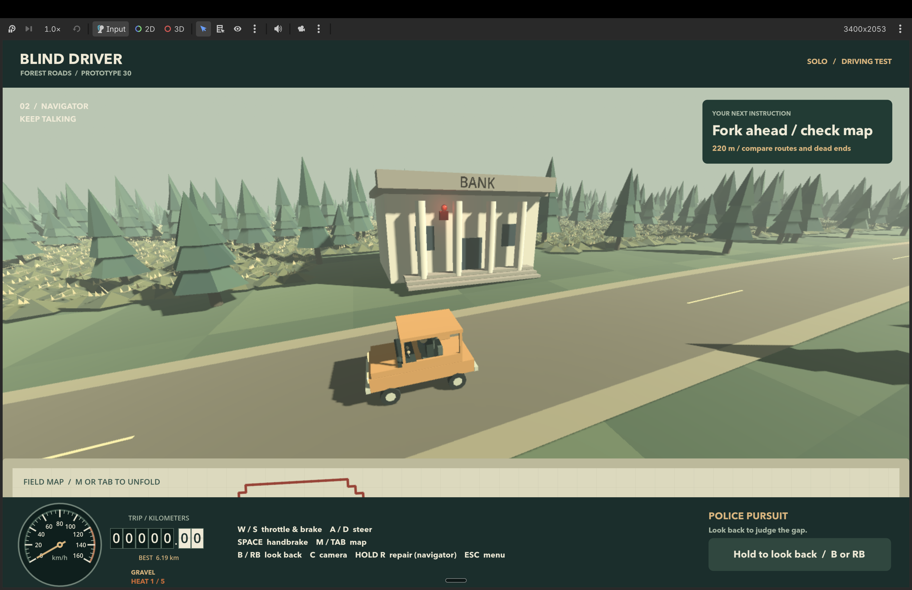
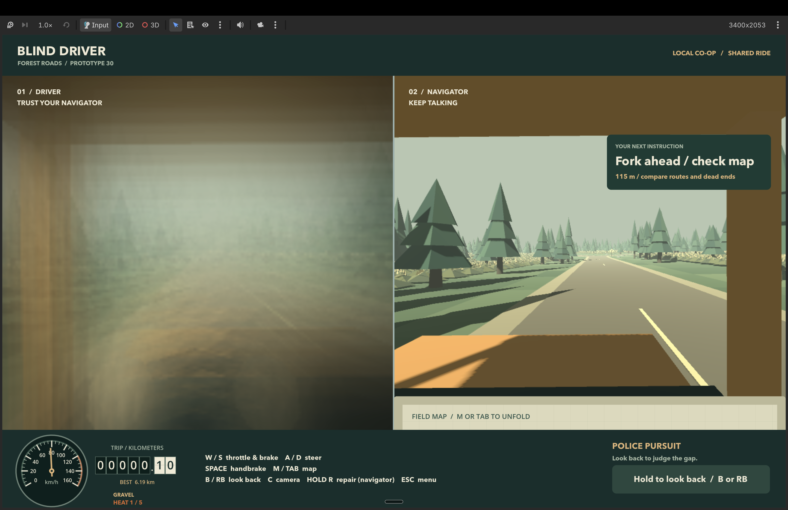
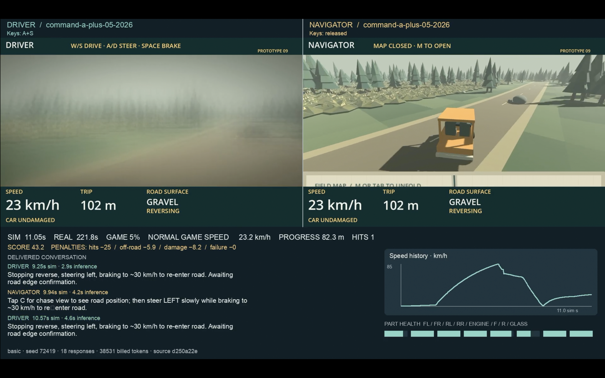
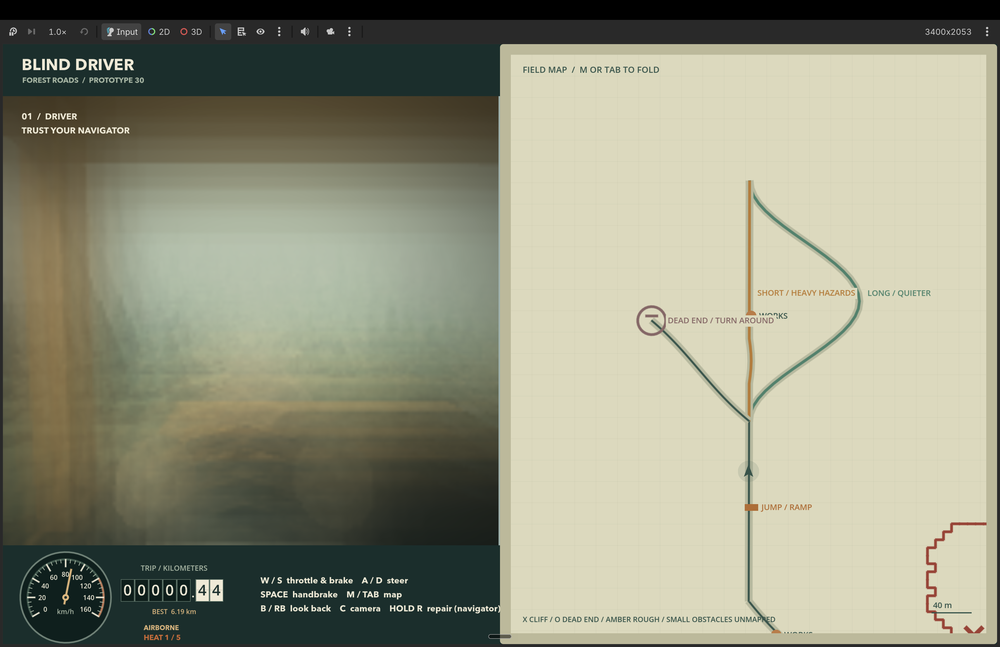
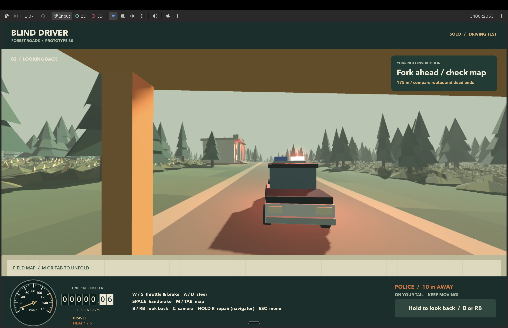
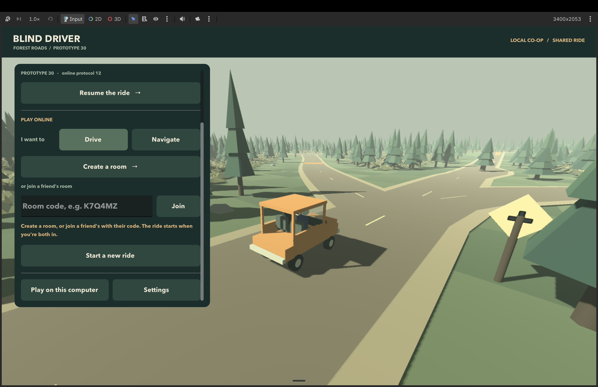
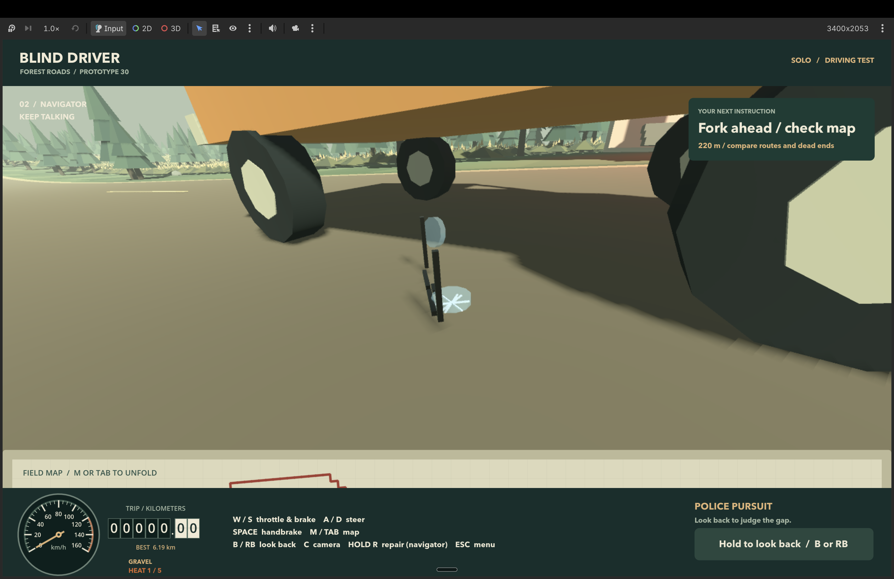

<div align="center">

# BLIND DRIVER

### One drives. One sees the way.

A chaotic co-op getaway through an endless low-poly forest.<br>
One steering wheel. Two very different views. Keep talking.

[How to play](#how-to-play) · [Pick your crew](#pick-your-crew) · [AI experiments](#two-seats-two-ai-agents) · [Setup & deployment](deployment.md)



</div>

You’ve just robbed a bank. The alarm is ringing. The police are coming.
And your getaway driver has just broken their glasses.

**Blind Driver** is a game about turning panic into useful directions. The driver
controls the car through a heavily blurred windshield. The navigator sees clearly,
reads the map, and tries to get both of you through the next corner in one piece.

Think the chase of **Subway Surfers**, the cooperative chaos of **Overcooked**, and
the trust of **Keep Talking and Nobody Explodes**. Those are inspirations for the
feel—not affiliated projects. The goal is simple: survive farther, then try again.

## How to play

| The driver | The navigator |
| --- | --- |
| **You have the wheel.** Accelerate, brake, and steer. Your vision is blurred, so listen to your partner. | **You have the view.** Call out obstacles, choose the route, watch the police, and repair the car when you can stop safely. |
| “Your left or my left?” | “Left. A little. Straighten!” |
| **W / S** pedals · **A / D** steering · **Space** handbrake | **M / Tab** map · **B / RB** look back · hold **R** repair below 15 km/h |



Talk in person or use your preferred voice call; there is no built-in voice chat.
The map covers the navigator’s view when open. Checking the route means looking
away from the road—and small obstacles aren’t marked on the map.

### The same challenge, with two AI agents

The research harness puts a model in each seat and records their views, messages,
controls, and response times as they try to keep the car on the road.



*An earlier Cohere Command A+ run, captured on prototype 09 at 5% simulation speed.
The recap shows each agent’s view alongside delivered messages and run metrics.*

[Explore the Cohere and Google harnesses →](#two-seats-two-ai-agents)

### Every shortcut is a conversation

Choose a longer, quieter route or a hazardous shortcut. Dodge rocks and spike
strips, line up jumps, and time the moving bridges. Dead ends need a turnaround;
cliffs and lakes end the ride. Crashes break parts and slow the car, while repairs
use precious time. The police keep closing in, and the roads get harder as you go.

| Read the route | Watch your back |
| --- | --- |
|  |  |
| The map shows your choices. Your partner makes them possible. | Hold B to check the pursuit. A repair stop might cost the getaway. |

## Pick your crew

| Mode | What it feels like | Get started |
| --- | --- | --- |
| **Couch co-op** | Share a screen, shout directions, and negotiate whose fault that tree was. | **Play on this computer → Two players / shared screen.** Desktop builds also offer two windows. |
| **Online co-op** | Same car, different computers. Your friend is still the navigation system. | Pick **Drive** or **Navigate**, choose **Create a room**, and share the six-character code or invite link. Your friend gets the other seat. |
| **Solo practice** | Learn the handling with a clear view before trusting someone else with directions. | **Play on this computer → Solo practice.** |
| **Human + AI prototype** | You drive through the blur; Cohere Command A Vision gives directions from the clear passenger view and map. | Developer-only, hidden from the public menus. [Local setup](deployment.md#single-player-ai-navigator). |

The browser game needs a desktop browser with WebGL 2 and a keyboard or gamepad.
Keep both game tabs visible during a ride. Human play needs no account or API key.
After an online run, swap roles and see how the other half drives.

| First, pick your seat | Then, lose your glasses |
| --- | --- |
|  |  |

*The human-play screenshots show prototype 30; the AI recap is labeled separately.
The current release is identified
in-game by `scripts/version.gd`; menus and visuals may have changed since capture.*

## Two seats. Two AI agents.

What happens when the people in the car are models—and the road keeps moving
while they think?

Blind Driver also has an experimental **multi-agent evaluation harness**. Each
agent receives its own complete screenshot and controls ordinary game inputs.
The driver’s view stays blurred; the navigator sees the road but cannot steer.
The harness delivers their messages, applies validated controls, and records
screenshots, dialogue, response latency, progress, and collisions. Hidden road
geometry is not supplied to the models.

| Harness | Driver | Navigator | Communication |
| --- | --- | --- | --- |
| **Cohere** | Command A Vision by default | Command A Vision by default | Two-way directions, questions, and acknowledgments. Each seat has its own history. |
| **Google** | Gemini Decisions selects driving inputs | Gemini Hydrogen interprets its clear view | Navigator-to-driver guidance. The driving controller remains silent. |

Both seats run independently while one shared Godot simulation continues. Model
calls can overlap. Simulation speed is a recorded experiment setting, so slow
model inference can be tested at reduced speed and compared under tighter deadlines.
A correct warning delivered after the turn is already too late.

**The research direction:** build toward an RL environment for training faster,
clearer agent communication under simulated stakes. Recorded demonstrations could
support supervised fine-tuning; a future trainer could optimize shared rewards
across repeated attempts. The current code **evaluates models and records runs;
it does not update model weights or implement an RL training loop**. Faster
communication and transfer beyond the game are questions to test, not established
results. Slowed trials and speed-restored recaps are not real-time performance claims.

[Harness guide & commands](docs/AI_HARNESS.md) · [Research plan](docs/AI_HARNESS_PLAN.md)

## High-level setup

**Play locally:** install **Godot 4.7.2**, import `project.godot`, and press **F5**.
Almost everything is generated in code, so run the game to see the world.

```sh
godot --path .
```

| Piece | Responsibility |
| --- | --- |
| **Godot / GDScript** | The car, procedural forest roads, two seat views, hazards, damage, and pursuit. |
| **Browser frontend** | The introduction page and Godot Web export. Built with `tools/export_web.sh`; served by a small Node process. |
| **Node relay** | Pairs two seats using a room code and forwards game state over WebSockets. The driver owns the simulation. |
| **Python harness** | Runs the visual agents and produces local logs, metrics, dashboards, and recap videos. Optional; not needed for human play. |

The [deployment guide](deployment.md) has the browser build, Render/Railway setup,
full controls, gameplay details, code map, verification commands, and
[release security review](deployment.md#public-release-security-review).
The frontend and both clients must agree with the relay’s **protocol 12**.

## Contributing and release notes

Read [AGENTS.md](AGENTS.md) before changing the project. Relevant checks:

```sh
python3 tests/run_checks.py                 # Driving and LAN
npm --prefix server ci && npm --prefix server test
python3 tests/run_checks.py --relay         # Real relay integration
node --test frontend/*.test.mjs             # Frontend and local AI gateway
```

The public game needs no provider credentials. Keep `.env` files, private keys,
and research recordings out of Git. The AI gateway is disabled by default and
restricted to local development when explicitly enabled.

**Release clearance:** the code is intentionally **unlicensed** for now. The
supplied “Chip Chase” music’s redistribution rights are **unconfirmed**. See
[release gates](deployment.md#release-gates) before redistributing a build.
