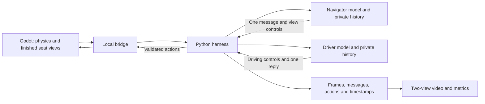

# Two-agent AI harness: prototype plan

Status: proposal for discussion; no harness or gameplay changes implemented.
Research checked on 2026-11-14. Repository inspected at `10900d0`.

## Recommendation

This is a feasible way to test visual perception, driving, communication, and
cooperation. Build a **Python harness controlling one rendered Godot game in
shared-screen mode**, with a separately configurable model for each seat. Each
model receives only its own finished screen and its conversation history. The
navigator sends one message, the driver chooses controls and replies, and the
exchange repeats while the simulation continues running.

Start at 5% simulation speed with a simple obstacle course. Record the actual
screens, delivered messages, applied controls, and both real and simulation time.
Produce a video showing both perspectives with a synchronized conversation panel.

The first deliverable is an **agent evaluation harness**, providing the foundation
for an RL environment. Calling pretrained models, retaining context, or improving
their prompts does not itself train their weights. Actual reinforcement learning
adds a policy that is updated from rewards over repeated runs. We can demonstrate
useful improvement before investing in that training system.

In this document, “Godot” refers to the existing game engine. Everything described
as a new command, setting, schema, file, or benchmark is proposed, not available
yet. Defaults below are starting hypotheses to measure, not established results.

## 1. What the repository already provides

| Existing component | Implication for the harness |
| --- | --- |
| [`scripts/main.gd`](../scripts/main.gd): `--split`, two seat cameras, shared world | One game process can supply both observations without a relay or desktop focus switching. |
| [`scripts/game_ui.gd`](../scripts/game_ui.gd): seat screens, map, dashboard, route card | Observe the finished UI, including the map covering the navigator's view. |
| [`scripts/car.gd`](../scripts/car.gd): action-based physical controller | Add an input source feeding the existing driving behavior; retain human input as the default. |
| [`scripts/procedural_world.gd`](../scripts/procedural_world.gd): seeded roads, hazards, difficulty | Add an episode seed and course profile before world creation. |
| [`scripts/main.gd`](../scripts/main.gd): challenge clock and pursuit updates | Add an explicit episode clock; audit gameplay timers when applying slow motion. |
| [`tests/run_checks.py`](../tests/run_checks.py): local Godot process management | Reuse process isolation and temporary personal-best storage. |

Three details need deliberate handling:

1. **Raw camera textures are not the players' screens.** Driver blur is a shader
   on `ui.driver_screen`, outside its `SubViewport`; the map and HUD are overlays.
   Capture after composition. Reading camera textures directly would omit
   important restrictions and information.
2. **The shared HUD is asymmetric.** The dashboard is at the left of the window,
   and the route card and map are on the navigator's side. Define and visually
   verify seat capture rectangles at a fixed layout. Do not give both agents the
   whole screen. Giving each seat a dashboard later would be an explicit UI change.
3. **Restarting does not reproduce the initial seed alone.** `reset_world()`
   preserves increasing road IDs, which also affect generation. Launch a fresh
   game process for each episode initially, preserving multiplayer's ID rules.
   Seeds improve repeatability but do not promise bit-identical Jolt physics or
   model responses.

## 2. Models: Cohere is a viable option

| Candidate | Verified capability | Proposed use |
| --- | --- | --- |
| Cohere `command-a-plus-05-2026` | Image and text input; structured outputs and tool use are documented. | First Cohere candidate for both roles, subject to account access and measured latency. |
| Cohere `command-a-vision-07-2025` | Image input, up to 20 images per request; no tool use. | Another visual baseline. Validated JSON is enough for the harness; tool calling is optional. |
| Cohere Labs `aya-vision-8b` | Open-weight image/text model; model card lists CC-BY-NC-4.0. | Possible smaller student after checking hardware, training-stack support, and intended-use licensing. |
| Google `gemini-3.8-flash` / `gemini-4-carbon` | Both current model pages list image input and structured outputs. | Alternative candidates; measure performance and latency before labeling one the better player. |

Sources: [Command A+](https://docs.cohere.com/docs/command-a-plus),
[Command A Vision](https://docs.cohere.com/docs/command-a-vision),
[Aya Vision model card](https://huggingface.co/CohereLabs/aya-vision-8b),
[Gemini Flash](https://aistudio.google.com/docs/models/gemini-3.8-flash), and
[Gemini Carbon](https://aistudio.google.com/docs/models/gemini-4-carbon).

Image support is established; ability to drive this game is unproven. A model good
at screenshots or documents may still struggle with depth, motion, small
obstacles, and continuous steering.

Use provider adapters with one internal request/response contract. Configure
provider, exact model ID, image detail, generation/reasoning settings, output cap,
and request deadline independently per seat. Pin versions where available and
record resolved identifiers. Run an image-plus-action-schema preflight before
an experiment. Cohere's image guide mentions JSON output, but its structured-output
compatibility list does not explicitly list Command A Vision; verify the exact
combination against the endpoint. Local validation is always required.
[Image inputs](https://docs.cohere.com/docs/image-inputs),
[structured outputs](https://docs.cohere.com/docs/structured-outputs).

Cohere currently documents 20 requests per minute for trial Command A+ and Command
A Vision, and 1,000 monthly calls for trial keys and production keys on newer chat
variants. Production arrangements for these variants require contacting Cohere.
Budget both seats together when sharing a model allowance; each agent does not
automatically get a separate quota. [Cohere rate limits](https://docs.cohere.com/docs/rate-limits).

At two calls per exchange, 20 requests/minute permits at most ten exchanges per
minute: one every six real seconds before headroom for errors/retries. That is
0.3 simulation seconds at 5% speed. Verify actual account limits before a large
evaluation. No paid model calls are needed to prepare this plan.

## 3. Architecture and the agent boundary



Python owns launch/cleanup, model calls, conversation ordering, validation, quotas,
episode budgets, logs, and offline video composition. Godot owns physics, clocks,
input application, screen capture, and authoritative results. Use asynchronous
I/O so inference and encoding do not block the game loop.

Add an opt-in local bridge, for example WebSocket on loopback with an ephemeral
port and per-run token. Prioritize control/events over image traffic using bounded
queues. A slow recorder may drop capture frames, with the drop logged; it must
not stall physics. Model credentials stay in Python, outside game files and
recordings. This bridge is separate from the multiplayer protocol and needs no
relay deployment.

Launch a standalone Godot window from Python using existing `--split` mode plus
new harness flags. An editor-launched game can later attach to the same bridge.
Use rendered Godot: headless physics tests do not establish that usable visual
observations are available in that mode.

Define two channels at the bridge boundary:

- **Agent observations:** own seat image(s), frame ID/timestamps, applied state of
  that agent's controls, validation feedback, delivered teammate messages, and
  its own retained history. Speed and route information come from what is visibly
  present in its screen.
- **Evaluator data:** seed, exact vehicle state, route progress, collisions,
  termination reason, clock health, and performance counters. These score/debug
  the run and must not enter an agent's prompt or memory.

The driver's image retains the configured blur. The navigator may open the map,
switch between existing seat/chase views, or look back using normal mechanics.
An open map covers the road view; never provide a hidden simultaneous clear road
frame. Preserve the driver's forward view during navigator actions. Start with
images and text; audio perception is a later, labeled experiment, particularly
relevant when police/sirens return.

The spectator video may show both seats and evaluator overlays. It is never an
agent observation. Fix screenshot encoding, resolution, and image-detail settings
within an experiment, and check readability of small hazards and map text.

## 4. Continuous simulation with alternating conversation

The agents take conversational turns, but the **world never waits for a turn**.
The first schedule follows the proposed navigator-then-driver exchange:

1. Capture the navigator's newest screen and deliver the previous driver reply.
2. Request one navigator response. Previous driving controls remain active until
   replaced or expired. Physics and the episode clock continue.
3. Validate/apply navigator view controls; deliver its one message to the driver
   with the timestamp of the observation behind it.
4. Capture a fresh driver screen and request controls plus one reply. Do not reuse
   a driver screenshot from before navigator inference.
5. Apply valid driver controls on the next physics tick and acknowledge the
   actual application time. Deliver its reply to the navigator's next turn.
6. Repeat, subject to a shared quota limiter. All waits count as real elapsed
   time. Never queue old screenshots or old decisions for catch-up processing.

Allow at most one request in flight per role. Two recent frames from that role's
own history can help estimate motion; timestamp them and cap image history. Map
changes become visible after the normal animation, in later observations. A
response that opens a map cannot already know its contents. The current map
animation takes 0.38 simulation seconds, or about 7.6 real seconds at 5% if left
scaled; partial-animation frames must be represented honestly.

If the navigator times out, advance to the driver with a missing-message event.
A driver's timeout advances to the next navigator cycle. Ignore late replies from
abandoned requests. Log invalid JSON, refusals, rate limits, and timeouts; never
silently call a stronger model or freeze the game to repair an answer.

Preflight providers with fixtures, settle the game, then mark one episode-start
event. Initial controls are neutral. From that event, first observations and all
inference delays count. Only the harness can reset/stop; agents cannot pause,
restart to erase mistakes, or change simulation speed.

### Structured controls

Illustrative driver response:

```json
{
  "observation_id": "driver-0042",
  "pressed": ["W", "A"],
  "hold_sim_seconds": 0.6,
  "message": "Turning left now. Tell me when to straighten."
}
```

Illustrative navigator response:

```json
{
  "observation_id": "navigator-0041",
  "map_open": false,
  "camera": "seat",
  "look_back": false,
  "message": "Rock on the right; steer slightly left, then straighten."
}
```

Driver controls allow W, S, A, D, and Space. Each response replaces the complete
held-key state; an empty list releases everything. Reject unsupported keys,
opposite simultaneous inputs, invalid fields, and out-of-range durations. Preserve
existing semantics: S brakes while moving forward and reverses once stopped;
Space is the handbrake. Named navigator states translate to ordinary UI
transitions and are idempotent; a retransmission must not toggle the map twice.
Reject conflicting map-open/look-back requests. A later analog-control profile
can mirror the gamepad, but should be compared separately.

Transport envelopes add protocol version, episode/exchange/request IDs, monotonic
sequence number, role, and timestamps. The harness sets these identifiers and
verifies the model's observation reference. Godot rejects wrong-episode, duplicate,
out-of-order, or stale actions and reports what actually applied.

Proposed bounds: one message of at most 240 characters per response, hold duration
0.05–1.0 simulation seconds, and observation age no greater than 1.0 simulation
second at application. Expiry is the earlier of the requested hold ending and
the observation freshness deadline. Calibrate these before freezing the benchmark.

On expiry or lost harness connection, a Godot-side watchdog releases throttle and
steering and applies brake-only behavior, without reversing. This fixed, logged
infrastructure fallback must not stop the episode clock or pursuit. Record time
under fallback so it cannot masquerade as agent driving. View state may persist,
but release held look-back input on expiry using a fixed, configured view-control
lease. Avoid OS keyboard focus and mixing human input into scored AI runs.

### Prompts and memory

Both prompts explain the goal, course features, controls, time scale, action
expiry, message limit, and continuing simulation. Include the JSON schema and
request only that response. Example role-specific content:

> **Driver:** Your forward view is blurred. Your navigator sees the road and can
> read a map. Drive as far as possible along the course within the time limit,
> avoiding collisions and leaving the road. Use the navigator's messages with your
> current screen. Reply briefly with what you are doing or what information you
> need. Holding S can start reversing after you stop.

> **Navigator:** You see clearly but cannot drive. Watch for obstacles and bends
> and send one short, actionable message per exchange. You can open the map, but
> it covers your road view while the car keeps moving. Say when to start and stop
> steering, and distinguish current observations from old advice. Your driver's
> view is blurred.

Keep independent histories even when using the same model. Each contains its own
observations/outputs and the delivered dialogue. Share only `message` between
seats, not private state or the other seat's images. Retain recent exchanges and
a bounded role-specific summary when needed; summarize only information that
role received. Log prompt versions, trimming, and summaries. Reset histories
between episodes unless testing an explicitly named learning condition. The replay
shows messages and optional brief declared intentions, not supposed access to
private internal reasoning.

## 5. Slow motion: feasible, with measurable tradeoffs

With simulation speed `s`, approximately:

```text
simulation seconds elapsed = s × real seconds elapsed
decision delay in simulation = s × (navigator latency + driver latency + overhead)
```

At 5%, ten real seconds are half a simulation second. A six-second exchange means
0.3 simulation seconds between decisions. At a displayed 60 km/h, that is about
five meters; a twenty-second exchange allows about 16.7 meters. Slow motion helps
but does not remove latency. These are illustrations, not measured response times.

Godot provides `Engine.time_scale`, scaling delta-based simulation without
automatically adjusting physics tick frequency or audio. Initially test
`time_scale = 0.05` with the ordinary 60 Hz physics setting. Reducing throttle or
rendering at three FPS would not implement the requested slowdown.
[Godot Engine reference](https://docs.godotengine.org/en/stable/classes/class_engine.html#class-engine-property-time-scale).

Keeping 60 wall-clock physics ticks means smaller simulated increments at 5%;
numerical trajectories can differ from 100% speed. Audit tick-counted state such
as `recovery_grace`, camera/map animation, streaming, and physics. Measure braking,
steering, collisions, and clock consistency at both speeds before claiming
equivalent difficulty. Fix speed and tick settings within a comparison. A later
fixed-simulation-step training backend needs separate validation.

Track three clocks: monotonic real time, Godot's authoritative episode simulation
time, and video presentation timestamps. Record clock pairs at capture and action
application; calibrate Python/Godot clock mapping. API deadlines, quotas, heartbeat,
and capture pacing use real time. Gameplay, action lifetimes, and course limits
use simulation time. Never scale network timeouts by 0.05. Record observed time
advancement and stalls rather than assuming the requested scale was achieved.

One simulation minute takes twenty real minutes. At one exchange per six real
seconds, it uses about 400 model calls across both roles. Ten simulation minutes
take 3 hours 20 minutes and about 4,000 calls. Token cost grows with resolution
and history. Estimate cost from a pilot, enforce request/token/spend budgets, and
mark budget exits as truncations. Keep 5% fixed initially; later sweep 10%, 25%,
and 100%. Do not automatically slow the game for a slower model in the same test.

## 6. A simple course and useful measurements

Add an opt-in `ai_basic_v1` profile, keeping normal human play as the default. Use
a continuing road, gentle bends, sparse static rocks/trees or cones, and enough
clearance for avoidance. Disable gap jumps, timed bridges, ramps, police, fatal
route choices, lakes, thorns, and heat escalation. Keep handling, blur, and seat
asymmetry. Grounded rollover and other applicable physical game-over conditions
still end a run. Ordinary collisions remain penalties/metrics; they need not all
end the episode.

The map remains accessible but is less useful on one continuing road. Add
`ai_navigation_v1` next with safe forks/rejoins and meaningful route decisions.
This separates steering/avoidance from route coordination. Pursuit and advanced
crossings become later curriculum stages.

**Survival time alone rewards standing still when police are disabled.** The
current odometer also counts movement regardless of useful route advance, so
circling or reversing can inflate distance.

Score maximum forward arc-length progress along the simple course's ordered
route, using bounded projection near the last valid road segment. Credit only
new progress and reject off-road shortcuts or jumps in projection. Retain scoring
progress independently of streamed-out geometry. Rejoining courses need explicit
checkpoints and consistent branch scoring before comparison. Raw odometer
distance remains a secondary descriptive metric.

Proposed full-episode cap: 60 simulation seconds, with a 500 m target for a clear
completion rate. Tune on development seeds before fixing the benchmark. End an
attempt with less than one meter of new progress over fifteen simulation seconds
as a disclosed stall failure. Use shorter ten-second episodes for the first
plumbing pilot.

Report progress, completion rate, collisions/severity, off-road time, failure
reason, simulation/real duration, applied actions per simulation second,
observation age, inference p50/p95, fallback fraction, API errors, tokens, and cost.
Separate task termination, time/budget truncation, and invalid infrastructure runs.
Use a fixed infrastructure-rerun policy rather than selectively retrying bad scores.

An eventual shared RL reward could start as:

```text
r = new valid route progress
    - collision penalty
    - off-road penalty × elapsed simulation time
    - terminal failure penalty
```

Choose/version coefficients on development data. Audit with stationary, circling,
reversing, and off-road policies. Log reward components individually. The evaluator
may use exact state for rewards without revealing it to deployed agents.

### Establish a baseline before claiming improvement

Use A and B for candidate models rather than assuming general intelligence
rankings predict driving skill. Compare driver/navigator A/A, A/B, B/A, and B/B
on the same held-out seeds/settings. Include no-message, fixed-message, and
accelerate-only baselines. A human pair with the same time/visual settings is
useful if available. A controller using world coordinates is a privileged
engineering upper bound and must be labeled accordingly.

Run short development episodes first, then budget a paired evaluation with unseen
seeds and repetitions. Report uncertainty and per-seed differences, not the best
video. Twenty held-out seeds is a useful initial target, not a statistical-power
guarantee. At sixty simulation seconds, four pairings over twenty seeds already
require about 26.7 hours serially at 5%, before repeats. Size the test after the pilot.

Freeze speed, course, blur, controls, message budget, memory policy, and provider
settings. Randomize run order to reduce service-load effects. The primary test
measures the whole system, including latency. A separate latency-controlled test
can isolate decision quality, but its results must be distinguished. A larger
model losing because it responds too slowly is meaningful for this task.

## 7. Recording both perspectives and their conversation

Capture the composed game frame once and derive seat images and spectator views
with a common frame ID/time. Start with a fixed 1440×900 shared-screen layout and
a bounded capture rate, for example ten frames per real second. At 5%, this
supplies ample samples for a 30 FPS normal-simulation-speed replay. Measure GPU
readback/encoding overhead; keep only the newest observation ready for inference.
Preserve every image actually sent to a model even if other frames are dropped.

Use a separate encoder process and compose offline with FFmpeg. Godot's Movie
Maker is documented as offline rendering rather than real-time gameplay capture;
it should not become the live inference experiment's clock.
[Godot recording guidance](https://docs.godotengine.org/en/stable/tutorials/animation/creating_movies.html).

Proposed layout:

```text
+----------------------------+----------------------------+
| DRIVER: blurred screen     | NAVIGATOR: road or open map |
| own HUD and applied keys   | own HUD and view state      |
+----------------------------+----------------------------+
| Sim 00:24.50 | Real 08:10.0 | Simulation 5% | Replay 20×  |
| Navigator → Driver: Rock right; move left now.           |
| Driver → Navigator: Turning left. Say when to straighten.|
| Request age / latency / control expiry / run result      |
+---------------------------------------------------------+
```

Timestamp messages when delivered, not when requests began. Also retain source
observation and request/completion times. Applied-key overlays use Godot
acknowledgments, not merely requested actions. Show held controls during inference;
never display a future reply early.

Produce two viewing modes:

- **Normal simulation pace:** use authoritative simulation timestamps for frame
  presentation. At steady 5%, this is approximately 20× real recording speed. A
  six-second real exchange lasts just 0.3 seconds in this video.
- **Readable review:** slower playback and rolling transcript, optionally with
  clearly labeled offline pauses around messages. Editing pauses never affect
  the scored run. Export the full timestamped transcript separately because fast
  text can be impossible to read.

Maintain timestamp sidecars for irregular capture; use actual clock mapping for
drops, stalls, and explicit operator pauses. Label interrupted/debug runs. Mute
audio initially; speed/pitch treatment is a separate recording concern.

Each run directory stores configuration/seed, source commit, Godot version,
model/prompt/schema versions, role histories, `events.jsonl`, evaluator metrics,
actual observation images, timestamped source video/frames, two-view replay, and
transcript. Log requested/applied actions separately. Retain failures as well as
successes. Frames/logs document what happened; replaying actions alone does not
guarantee identical physics.

## 8. How improvement could become reinforcement learning

| Stage | What changes? | What it demonstrates |
| --- | --- | --- |
| Evaluation | Nothing learns; fixed models and prompts. | Whether the task works and which combinations perform better. |
| Prompt coaching | A stronger model reviews training runs and proposes instructions/examples. | Improvement in the configured agent, without weight training. |
| Imitation / distillation | Train a smaller model on successful observations, messages, and actions. | Learned behavior through supervised fine-tuning on demonstrations. |
| Reinforcement learning | Update a trainable policy using rewards from its own attempts. | Policy improvement through interaction and reward. |

The lowest-cost first improvement experiment is **offline coaching**: freeze a
small model and partner, collect failures on training seeds, ask a stronger model
for a short driving/communication guide, then compare original/revised prompts
on untouched seeds. Include coaching cost and evaluate with the coach absent.
Advice supplied during every run measures an assisted team; context retained
within one run is not evidence of lasting training.

For weight changes, collect successful demonstrations and fine-tune a small
vision-language policy to emit the same JSON contract. Role-specific targets must
use only observations available to that role: do not ask a blinded student to
imitate decisions requiring an unseen navigator screen. Preserve observation and
delivery timing so action labels match their inputs. TRL documents supervised
vision-language training, one possible path subject to architecture support.
[TRL SFT](https://huggingface.co/docs/trl/sft_trainer#training-vision-language-models).

Successful teacher trajectories can omit mistakes a student encounters. A later
DAgger-style cycle can collect student rollouts, request teacher corrections for
those observations, and retrain. The teacher should see the student's allowed
information at that point; hindsight can diagnose failure but is unavailable at
deployment. This is still imitation, rather than direct reward optimization.
[Original DAgger paper](https://arxiv.org/abs/1011.0686).

For RL, keep the observation/action boundary and add versioned rewards,
repeatable initialization, termination/truncation flags, and a trainer. Train one
seat against a frozen partner first. Training both simultaneously changes each
agent's effective environment and complicates credit assignment. Later alternate
partners or train jointly with a shared reward. A centralized critic can use
evaluator state during training while deployed actors retain restricted views.

Hosted inference access does not establish access to weight updates, arbitrary
multimodal fine-tuning, or online RL. Treat hosted Cohere/Google models initially
as players, teachers, or reviewers. Choose trainable weights and suitable compute,
or explicitly verify an appropriate hosted training product, before promising
reward-based fine-tuning. Training a compact visual driver while keeping a language
navigator is another legitimate staged direction, but changes the model comparison.

Standard RL tooling often exposes `step()`. That need not make live evaluation
turn-based: a training adapter can advance continuous physics over fixed
simulation intervals, with held controls and explicit message delays. A Gymnasium
wrapper suits one trainable seat with a frozen partner. PettingZoo's Parallel API
suits synchronized two-agent training intervals with different observation/action
spaces. The live asynchronous scheduler is not itself that Parallel API.
[Gymnasium environment API](https://gymnasium.farama.org/api/env/),
[PettingZoo Parallel API](https://pettingzoo.farama.org/api/parallel/).

Five-percent-speed API rollouts suit demonstrations/evaluation but are expensive
training data. A later backend should support multiple instances, controlled
simulation steps, and faster execution with local policies. If training pauses
for inference, it removes the latency challenge: model action delay/frame age
explicitly, then evaluate the trained policy in the original continuous harness.
Preserve one fixed held-out continuous-time benchmark throughout the project.

## 9. Proposed implementation order

1. **Bridge and observation proof.** Add opt-in local control, finished seat
   captures, clocks, episode IDs, and acknowledgments. Use scripted responses;
   verify blur/map isolation and that delayed clients do not stop physics.
2. **Basic course and scoring.** Add profile and seed-before-generation settings,
   fresh-process episodes, progress scoring, stall/time limits, and isolated record
   files. Verify normal gameplay remains unchanged.
3. **Two model agents.** Add Python adapters, schemas, prompts, histories,
   alternating conversation, quotas, stale-action rejection, watchdog, and
   request/token/spend caps. Measure a pilot before selecting defaults.
4. **Replay and baseline report.** Produce synchronized two-view video/transcript
   and metrics; run paired candidate comparisons and ablations.
5. **Improvement experiment.** Try offline coaching on held-out seeds; proceed to
   imitation and RL once the benchmark distinguishes useful play.

Suggested boundaries: `scripts/ai_bridge.gd`, a shared input-source adapter,
world-generation profile configuration, and `tools/ai_harness/` for launch,
providers, scheduling, recording, and evaluation. Version prompts/configurations
alongside the harness; keep large run artifacts out of Git. An eventual command
could be `python3 -m tools.ai_harness run --config experiments/basic_cohere.yaml`;
this is illustrative and is not implemented by this document.

Acceptance checks for the first implementation:

- Driver capture includes blur; navigator capture includes map occlusion. Neither
  includes the other seat or evaluator overlays.
- Controls match human steering/braking/reversing; map use never affects the
  driver's camera. One human/one AI can be a later diagnostic.
- Long inference delays leave the world advancing. Invalid/stale/duplicate or
  prior-episode responses cannot apply controls. Killing the harness triggers
  the Godot watchdog without pausing the episode.
- Fixed-seed fresh episodes reproduce course configuration; other seeds vary it.
  Task clocks and limits behave correctly at 5% speed.
- Stationary/circling policies cannot achieve high progress. A simple scripted
  baseline makes progress. If all models fail, audit difficulty, perception, and
  controls before concluding anything about intelligence.
- Video/transcript agree with capture, delivery, and application events. Report
  recording overhead, dropped frames, quotas, and budget exits.
- Run README driving/LAN checks for gameplay/input changes. Run server plus relay
  checks if shared networking changes, and resilience checks if recovery changes.
  No relay/protocol changes are currently proposed.

## 10. Decisions to revisit together

Proposed defaults: Cohere A+ first with a Google fallback, one shared-screen Godot
process, alternating messages over continuous 5%-speed simulation, pixel-only
observations, keyboard-like controls, no pursuit, and progress-based evaluation.
The most useful early decisions are available API quota/budget and whether the
first demonstration emphasizes obstacle avoidance or route communication. Start
with avoidance and add safe route choices once it works; retain advanced hazards
for later stages.

The first success is a reproducible run where both agents use their own screens,
communicate, drive, and produce a trustworthy score/replay. Model differences
would be a useful baseline result. A measured gain from offline coaching is an
accessible next result; weight training and RL can build on those interfaces.
